# Afterglow Lyrics: Visual Comparison & Test Report

**How the screenshots were made:**
- **Left half of each image:** a frame from the reference video.
- **Right half:** Afterglow at 1600×900 in fullscreen, with the matching look applied.
- **Moment:** paused just after a real word step, with the controls auto-hidden.

The test songs use **generated abstract covers** (no real album art) and Afterglow's own test lines, so cover content and words differ from the videos by design. Compare layout, sizing, colour, motion and frame.

"Before" is the first capture this round; "after" follows the fixes listed. A second moment of each look is in `docs/lyrics-visuals/*-second-moment.jpg`.

---

## 1 · Orange Typography ← "Ambient lighting in your Mac" (V6)
| Aspect | Reference | Afterglow |
|---|---|---|
| Typography | heavy rounded grotesque | Nunito 900 ✓ |
| Size variation | huge current word, small previous and next | same ✓ |
| Positioning | centred reel, slots almost touching | centred; spacing fixed (see below) |
| Artwork | none (black) | none ✓ |
| Border | thin amber line, notch, brighter at the bottom | amber strip + notch ✓ |
| Timing / transitions | about 0.2–0.3 s steps with vertical smear; card for line openings | same; steps scale with the gap to the next word |

**Three biggest differences, and fixes:**
1. **Text colour:** the reference is saturated orange, mine was cream. Fixed with a new **Text tint** setting; this look uses 85%.
2. **Slot spacing was too loose.** Fixed by moving the previous and next slots closer: −0.98 → −0.8 em and 0.8 → 0.7 em.
3. **Pictograms were too large.** Fixed by shrinking them from 0.62 to 0.5 em.

Before: 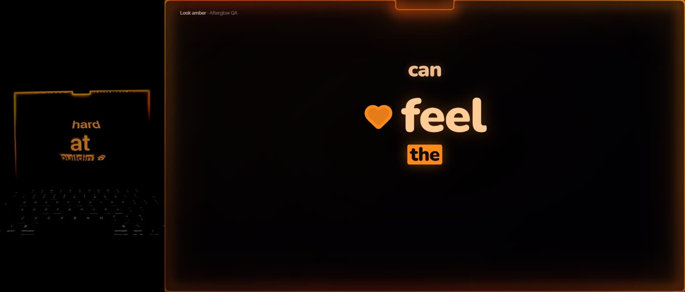
After: 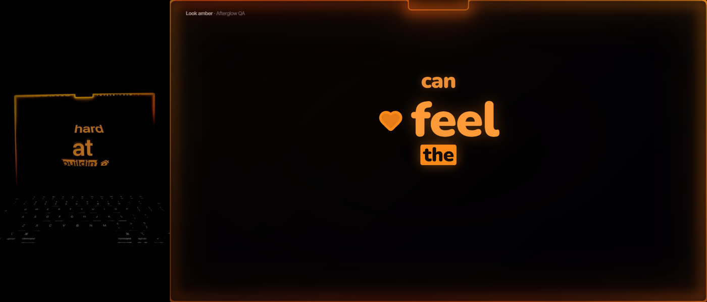

## 2 · Pink Artwork ← "Can't stop looking at my screen" (V1)
| Aspect | Reference | Afterglow |
|---|---|---|
| Typography | heavy, two-tone pink→lilac; newest word pale yellow on a magenta block | gradient older words; newest on a magenta→pink block ✓ |
| Size variation | by word weight ("for" small even when newest) | fixed (see below) |
| Positioning | vertical pile, staggered left and right | fixed (see below) |
| Artwork | full-bleed cover first, then black | "Clear" album art behind the lyrics ✓ |
| Clock | above the lyrics later in the video | clock on ✓ |
| Border | pink with a violet corner, notch | ✓ |

**Three biggest differences, and fixes:**
1. **The newest word was always enlarged.** It now keeps its own weight: `max(0.72, w)·1.14` → `w·1.08`.
2. **Stagger was too subtle.** Widened from 2.6 to 3.6 em.
3. **Words were hard to read on bright covers.** Added a soft dark shadow whenever album art is behind the lyrics (`--ly-art-shadow`).

Before: 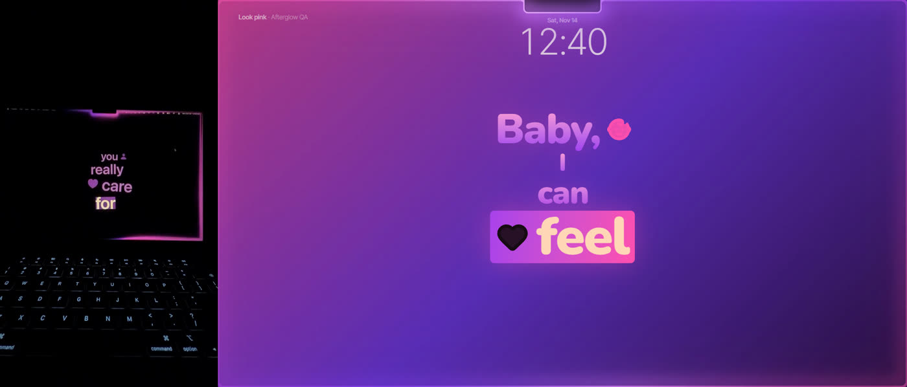
After: 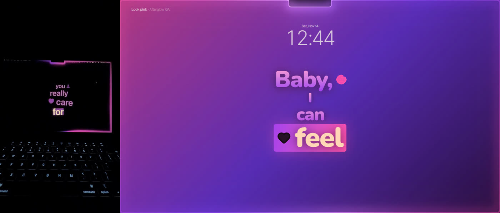

## 3 · Amber Clock ← "Peak music setup" (V2)
| Aspect | Reference | Afterglow |
|---|---|---|
| Typography | peach type; italic line openings; next word on an orange block | ✓ (italic first words) |
| Clock | small bold date, large thin time, about 16% from the top | was at about 3%; fixed (see below) |
| Positioning | centred reel under the clock | ✓ |
| Border | warm orange following the art, notch | follows the art ✓ |

**Three biggest differences, and fixes:**
1. **The clock sat too high.** Fullscreen clock offset changed from 4 to 11 vh.
2. **Slot spacing.** Shared fix with look 1.
3. **Text warmth.** Tint 55%.

Before: 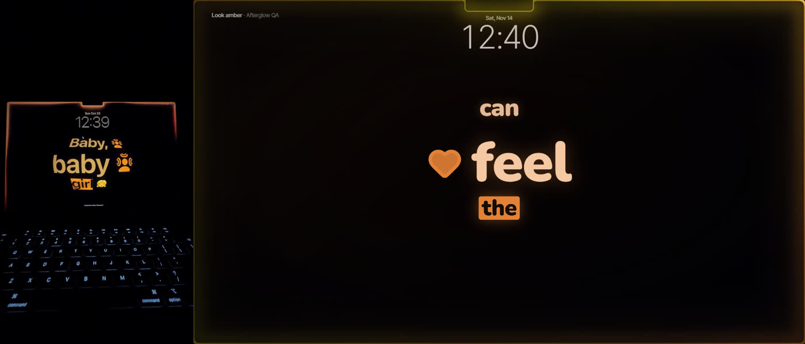
After: 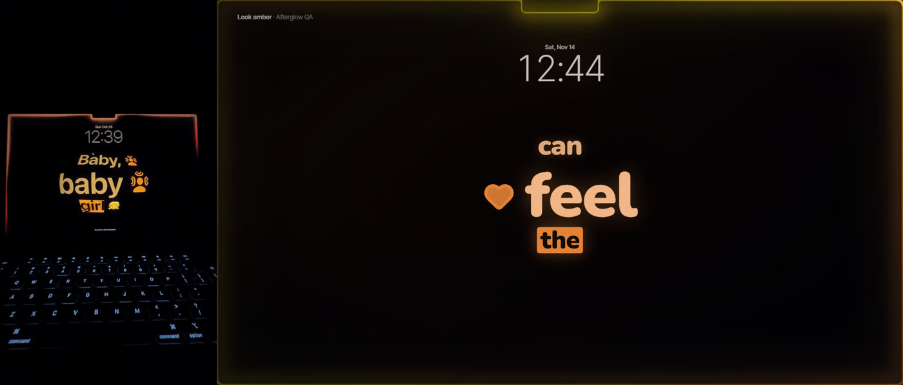

## 4 · Blue Over Art ← "Rate the music setup" (V3)
| Aspect | Reference | Afterglow |
|---|---|---|
| Typography | white heavy type with a soft shadow, **no blocks** | new "Reel over art" variant ✓ |
| Artwork | clear, full-bleed, **undimmed** | "Clear", 0% dimming ✓ |
| Border | thin electric blue, no notch | ✓ |

**Three biggest differences, and fixes:**
1. **Icons used the light colour (blue).** Over art they now take the word's ink (white).
2. **Slot spacing.** Shared fix.
3. **Test artwork.** My generated cover is only noise, so the reference's photographic depth can't be compared. That's a test-asset limit, not an app difference.

Before: 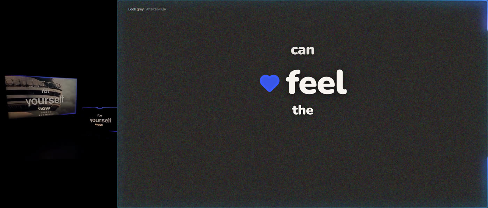
After: 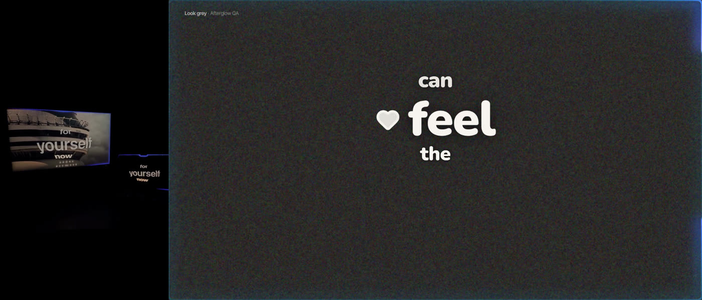

## 5 · Red Constellation ← "The perfect late night setup" (V5)
| Aspect | Reference | Afterglow |
|---|---|---|
| Nodes | four-point stars; the sung word's node is a glowing red ring | ✓ (rebuilt this round) |
| Lines | hairline through the words in order, crossing | ✓ |
| Word sizes | sung word large and bold; weighty words medium; small words small | ✓ |
| Spread | about 60% × 30% of the screen | about 74% × 56% (fixed from 90% × 66%) |
| Change | when the next line's timestamp starts | ✓ (driven by line timestamps) |

**Three biggest differences, and fixes:**
1. **Bug: lines stopped short of their stars.** The draw-in animation used dash lengths in a different coordinate space from the non-scaling stroke. It now fades in instead.
2. **The faint path was too faint.** Opacity raised from 0.32 to 0.5.
3. **The composition was too spread out.** Tightened to 74% × 56%.

Before: 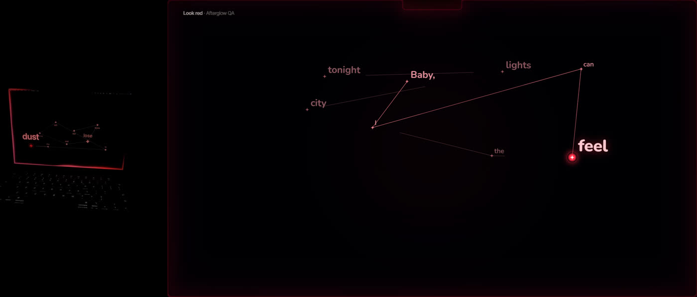
After: 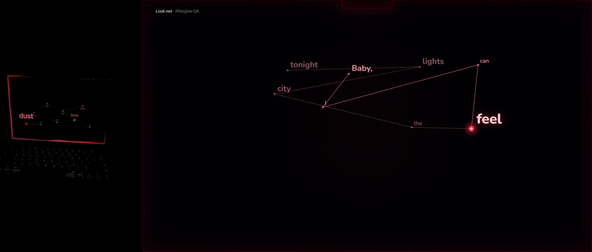

## 6 · Gold Ring ← "Music like this >>" (V4)
| Aspect | Reference | Afterglow |
|---|---|---|
| Ring | the cover's own circle frames the reel | an SVG ring (heavy outer, ticked inner) around the reel, for covers without one |
| Typography | cream words; next word on a pale yellow block | ✓ |
| Artwork | clear, full-bleed | "Clear", 10% dimming ✓ |

**Three biggest differences, and fixes:**
1. **Icons vanished into the yellow cover.** They now use the cream ink.
2. **My first test cover had its own ring,** which doubled up with the app's ring. Replaced the test cover with a ring-free one.
3. **Proportion.** The reference ring is slightly larger relative to the words. **Not changed:** it depends on each cover.

Before: 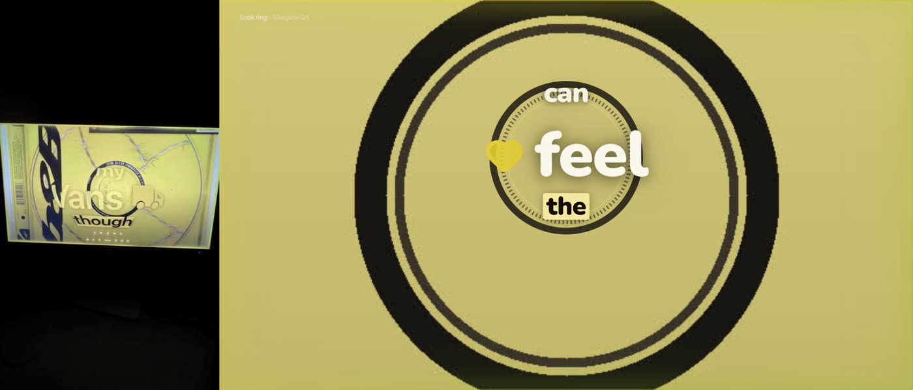
After: 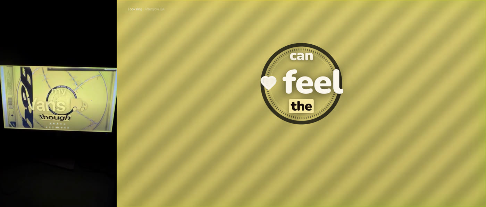

## Hindi (Devanagari and Roman)
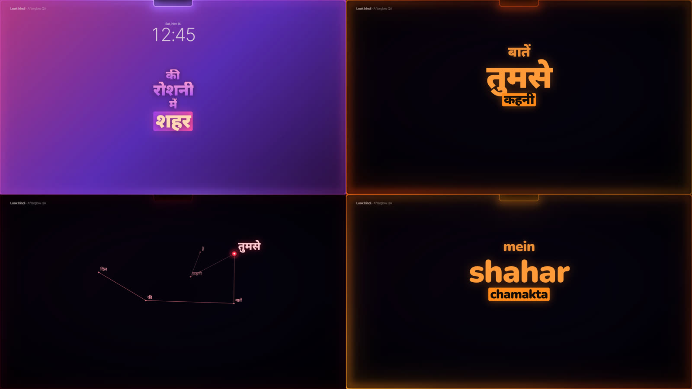

The four captures, clockwise from top left:
1. **Stack over art:** small का/की/में, large रोशनी/शहर.
2. **Reel:** बातें / तुमसे / कहनी.
3. **Constellation.**
4. **Roman toggle:** "mein / shahar / chamakta".

Matras and conjuncts render intact (Noto Sans Devanagari). The lines are original sample text written for this test.

---

## Round 4 · The reel, rebuilt from "Peak music setup" at 24 fps

I compared your screen recording of Afterglow against the reference frame by frame (24 fps crops of the laptop screen) and measured the sharp frames.

| | Reference | Before | Now |
|---|---|---|---|
| Typeface | neo-grotesk **Bold**, tight tracking, straight-tailed "y" | Nunito Black (rounded) | Inter Tight 720, −0.035 em |
| Current word | ≈24% of screen height, yellow-cream, barely any glow | ≈18%, coloured like the light, strong glow | `min(22vh, 13vw)`, cream nudged by Text tint, faint glow |
| Previous word | 48% size, **left-aligned to the current word** | 44%, centred | 48%, left edges aligned (measured widths) |
| Next word | 47%, sharp-cornered solid block, descenders hang below | 40%, rounded block | 47%, sharp block, icon outside the block |
| Placement | clock 17.5%, current word 57%, next 71% down the screen | reel high (≈39%) | 17.5% / 59% / 72% |
| Step | **3–4 frames (≈0.15 s)** of stacked, blurred ghost copies, then crisp | 0.3 s ease with a scaleY stretch | 0.15 s with 3 blurred ghost copies, then crisp |

**How the step works.** Every frame computes each word's position, size, opacity and block from the playback time. The ghost copies are the same reel a few milliseconds earlier, slightly blurred, which gives the zoom and motion "fishtank" streaks. Pause freezes it, seek jumps exactly, and nothing is scheduled. The words become GPU layers only while moving, so the type is crisp at rest.

**Frame rate** (headless Chrome, GPU, this 2-core laptop): 50–53 fps with words every ≈0.2 s (always mid-step), 60 fps otherwise.

Top: reference. Bottom: Afterglow. Consecutive 24 fps frames.
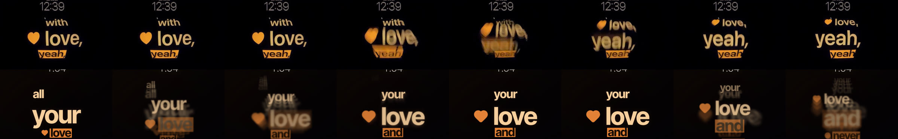

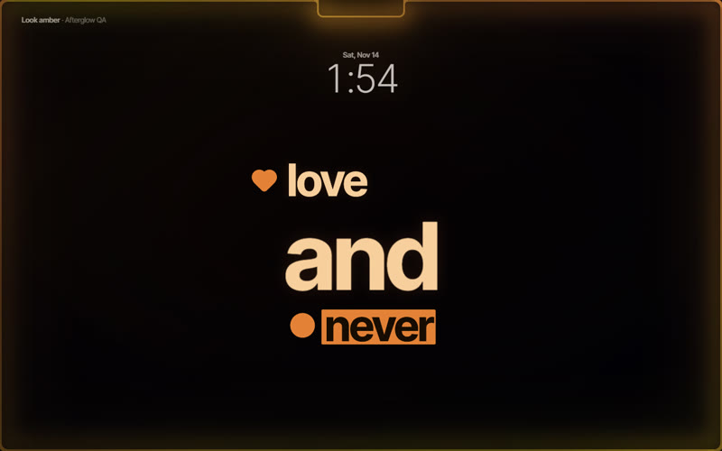

### The "fishtank" entrance and exit (every frame of the reference at 24 fps)

| Moment | Reference | Afterglow |
|---|---|---|
| The block | A **band** from the cap line to the baseline, leaning like italic type. The word in it is dark, so whatever sticks out vanishes into the black: ascenders touch the rim ("=illin'"), descenders are cut off | Same band (`skewX(-7deg)`, cap line to baseline), dark ink, nothing clipped by code: the black does it |
| New line | Hard crossfade, about 2 frames. The old reel fades where it stands; the first word appears whole, at full size, in its band | 0.085 s crossfade, no movement, no smear |
| Surfacing (band → current) | The band rises past the word while it grows and smears; within a frame the ink turns cream and the band drains away | Band top rises (0.45 of the step), ink flips (0.12), band drains (0.3) |
| Group centring | First word of a line (no previous word yet) sits about ⅓ word higher, so a card surfacing into it also **rises**, giving the vertical streaks | Same lift (−0.33 em; +0.3 em for a line's last word) |
| New next word | Appears close to its slot: a short rise from just below, nearly full size, already in its band | Rises 0.3 em from 85% size |
| Oldest word | Fades **in place** with a tiny upward drift, gone in about 2 frames | Same (opacity at double speed, −0.14 em drift) |
| Smear | 4–6 stroboscopic copies trailing the motion, mostly vertical, little blur | 4 trailing copies (the reel a few ms earlier), 0.012 em blur |

Top: reference ("Fillin'"). Bottom: Afterglow ("Give"). Consecutive 24 fps frames.
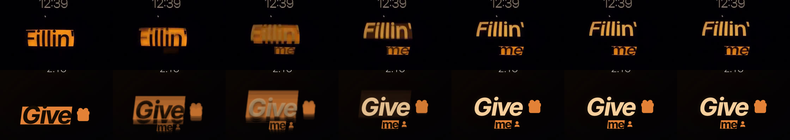

**Frame rate:** with the machine otherwise idle, an earlier build of this reel measured 50–53 fps with words every ≈0.2 s. During the final measurement something else was using the machine (the ambient view, normally 60 fps, measured 44–58). Under that load the reel measured 28–39 fps, the same with or without the smear, so the smear isn't the limiting cost.

### Fisheye lens (on by default)

The lyrics bend as if printed on a bubble: the middle swells, the edges shrink and lean away, a top line arches up and a bottom line smiles. It's a real distortion of the glyphs (an SVG displacement filter), not a font, so it works with any typeface and with Devanagari.

- **Reel styles:** the lens is fitted to the word cluster (5.8 × 3.4 em), so the current word sits in the swell.
- **Other styles:** the whole block bends.
- **Constellation:** stays flat.
- **Round, not stretched:** Chrome scales both axes of the displacement by the box width, so vertical offsets are pre-multiplied by each box's measured aspect.
- **Toggle:** Settings → Lyrics → Fisheye.
- **Cost** (same run, quiet machine, words every ≈0.2 s): reel 38 fps with the lens against 48 without; Stack and line styles 36–49 against 48–54. At rest nothing is redrawn.

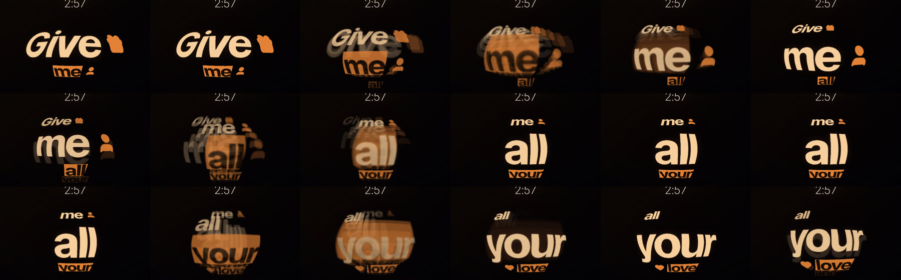
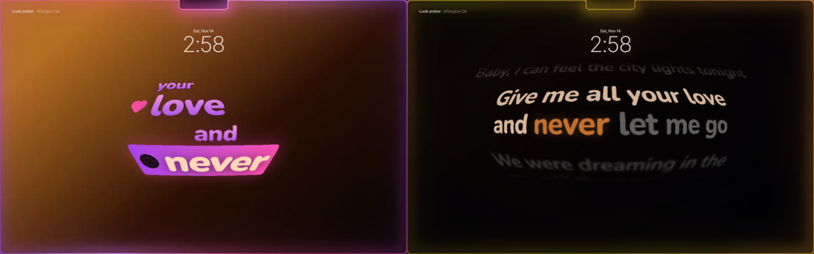

---

## Functional tests (final build)

| Suite | Result |
|---|---|
| **Lyrics QA:** local audio with a known-timestamp LRC. Pause, resume, seek both ways, track change, every style while playing, fullscreen in and out, reload, offset, line navigation, missing lyrics, lyrics off, settings preview | **24 / 24** |
| **Hindi and lookups:** untagged Hindi download found on LRCLIB; Devanagari ↔ Roman refetch; picker; cached 3-minute transcription with word timing on all 6 repeats | **9 / 9** |
| Round-2 suite (views, lyrics, artists, settings) | **44 / 44** (two expectations updated for renames this round: "Pink Haze" → "Pink Artwork"; the attribution now names the matched song) |
| Round-1 suite (playback, sources, lighting, immersive) | **35 / 35** |
| Transcription API: dedupe, cache, cancel and resume, bad input | all as expected (see the performance report) |
| `npm run build` | passes, no type errors |

**Not tested:**
- **Network:** a slow network wasn't simulated.
- **Browsers:** Firefox and Safari weren't tested.
- **Hindi audio:** Hindi transcription accuracy (no authorized Hindi recording).
- **Real-GPU frame rates:** headless Chrome only.
